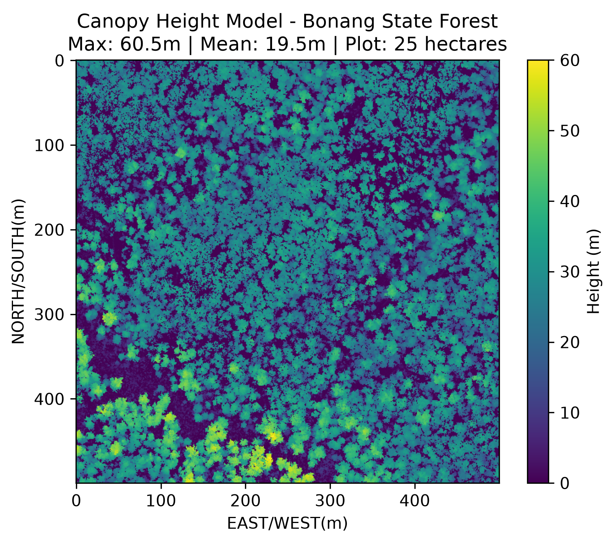
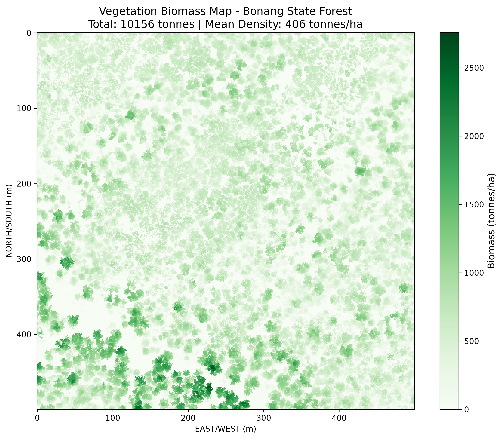

# Step 1: Canopy Height Model (CHM) Generation

To estimate above-ground biomass, We first convert the 3D normalized vegetation point cloud into a 2D raster grid called a Canopy Height Model (CHM). The CHM represents the forest from a top-down perspective, where each 1m × 1m pixel contains the maximum vegetation height within that cell.

Using `scipy.stats.binned_statistic_2d`, we bin the X and Y coordinates of all normalized vegetation points and calculate the maximum Z (height) value for each bin. Empty bins (cells with no vegetation returns) were filled with 0.0m to represent bare ground or canopy gaps.

### Results
- **Grid Shape:** 500 × 500 pixels (500m × 500m plot)
- **Total Grid Cells:** 250,000
- **Empty Pixels (Gaps):** 23,867 cells set to 0.0m (9.5% of the plot)
- **Max Height in CHM:** 60.50 m
- **Mean Height in CHM:** 19.49 m

The resulting CHM provides a continuous surface of canopy heights, ready for allometric biomass calculation.

# Step 2: CHM Visualization

The CHM is visualized as a top-down heatmap using `matplotlib.pyplot.imshow()`. Each pixel is colored according to its canopy height value, with the color scale locked to 0–60m for consistent interpretation. 

### Results

The CHM visualization reveals the spatial structure of the forest canopy, showing clusters of tall emergent trees and areas of shorter vegetation. 

# Step 3: Biomass Calculation

Applied an allometric power-law equation to convert canopy height to above ground biomass (AGB):

**Equation:** `AGB = a × H^b`  
Where:
- `AGB` = Above-Ground Biomass (kg/m²)
- `H` = Canopy height (m)
- `a = 0.05`, `b = 2.1` (generalized eucalypt forest constants)

## Results
- **Total Biomass:** 10,155.5 tonnes
- **Mean Biomass Density:** 406.2 tonnes/ha
- **Plot Area:** 25 hectares

This biomass density is consistent with mature Australian wet sclerophyll forests, which typically range from 300-600 tonnes/ha.

# Step 4: Biomass Visualization

Created a spatial heatmap showing biomass distribution across the forest. Each 1m² pixel is colored by its biomass value (tonnes/ha).

## Results
The biomass map reveals:
- High biomass areas (>400 tonnes/ha) concentrated in dense canopy zones
- Lower biomass areas corresponding to canopy gaps 

